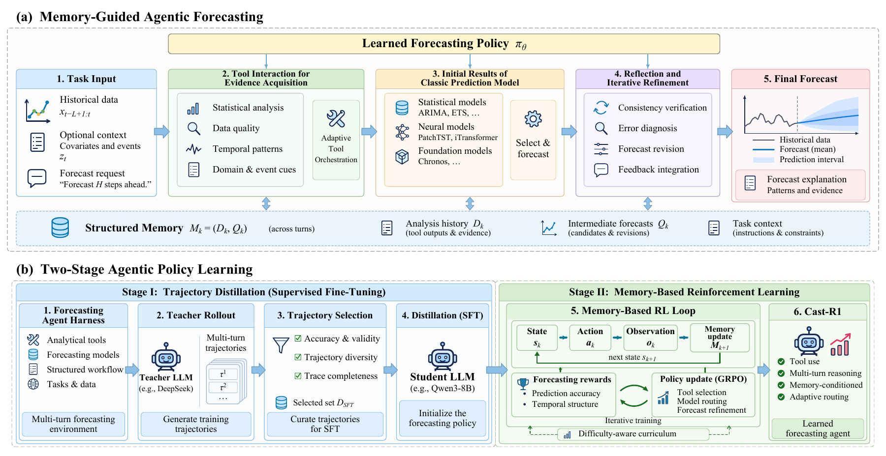
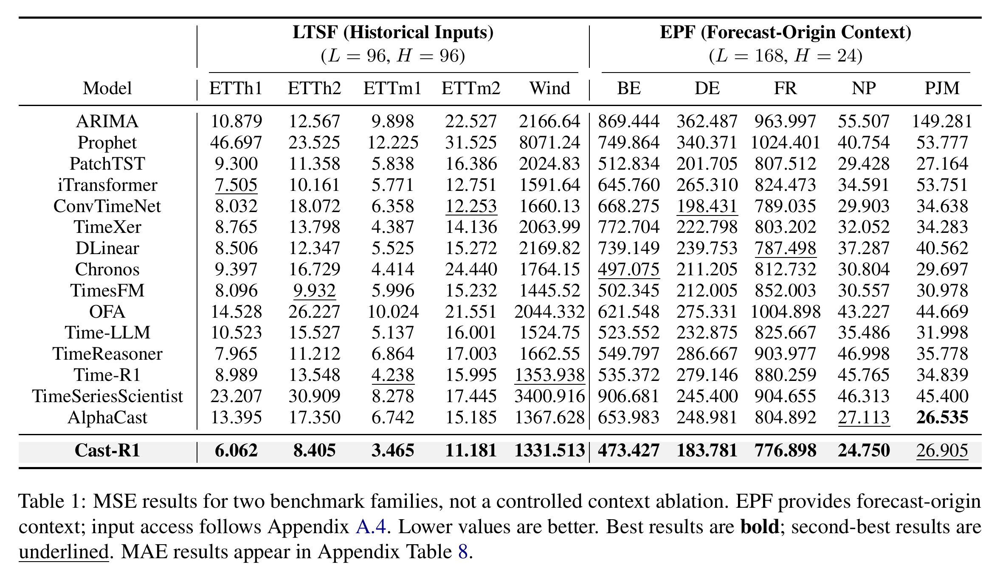
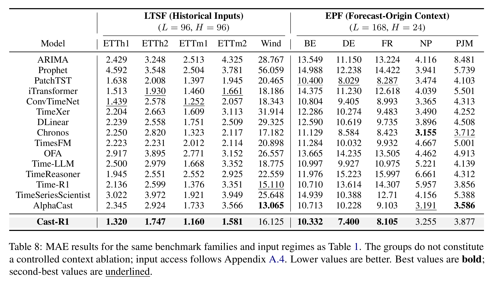

<div align="center">
  
  <h1>Cast-R1</h1>
  <p><strong>Learning Agentic Time Series Forecasting via Trajectory Distillation and Memory-Based Reinforcement Learning</strong></p>
  <p>
    <a href="https://arxiv.org/abs/2602.13802">Public Preprint</a> ·
    <a href="https://github.com/ustc-time-series/Cast-R1">Code</a> ·
    <a href="#quick-start">Quick Start</a> ·
    <a href="#citation">Citation</a>
  </p>
</div>


**Contents:** [Overview](#overview) · [News](#news) · [Framework](#framework) · [Installation](#installation) · [Quick Start](#quick-start) · [Experiments](#experiments) · [Datasets & Models](#datasets--models) · [Reproduction](#reproduction) · [Citation](#citation) · [Acknowledgements](#acknowledgements) · [License & Contact](#license--contact)

## Overview

Cast-R1 studies whether a smaller LLM can learn to use analytical tools, select forecasting models, and refine their predictions. It formulates time series forecasting as a sequence of decisions over historical observations, available task context, and tool-derived evidence.

A single **Qwen3-8B** policy is trained across ten datasets. Its main components are:

- **Trajectory distillation:** a DeepSeek-V3.2 teacher produces complete forecasting interactions. Execution-valid trajectories are ranked by final-forecast MSE within each dataset; the best 120 per dataset form 1,200 demonstrations for response-only SFT.
- **Memory-based reinforcement learning:** multi-turn GRPO optimizes the distilled policy using terminal forecasting rewards. The same trajectory advantage supervises generated tokens across all turns.
- **Structured memory:** each policy state is reconstructed from task inputs, Analysis History, and Prediction Results. Diagnostic evidence and intermediate forecasts guide later decisions.

The workflow supports long-term forecasting on ETT/Wind and short-term electricity price forecasting on NP, PJM, BE, DE, and FR.

## News

- **2026-10-14:** released the paper-aligned training and evaluation implementation, including teacher trajectory selection, SFT, multi-turn GRPO, and CPU integration checks.
- **2026-02-14:** the [initial Cast-R1 preprint](https://arxiv.org/abs/2602.13802) was posted on arXiv.

## Framework

<p align="center">
  
</p>

The figure shows the manuscript's overall framework. This implementation uses **ARIMA, Chronos-2, PatchTST, and iTransformer** as its forecasting pool and evaluates point forecasts.

**Forecasting workflow**

1. **Preparation:** the policy calls diagnostic tools to characterize data quality, statistics, temporal dynamics, events, and residuals.
2. **Forecasting:** the policy selects one model using the accumulated evidence and stores its intermediate forecast.
3. **Reflection and refinement:** the same policy checks the forecast against recent observations, task context, and memory, then generates the final answer.

Memory is episode-local: `M = (D, Q)`, where `D` is Analysis History and `Q` is Prediction Results. Each step uses fresh system/user messages assembled from this state. Earlier assistant responses and raw tool messages are not appended as additional conversation history.

**Implementation modules**

| Module | Purpose | Entry point |
| --- | --- | --- |
| Forecast-origin task | Historical targets/covariates and permitted future context | [forecast_task.py](recipe/time_series_forecast/forecast_task.py) |
| Shared forecasting harness | Diagnostics, model invocation, and state construction | [forecast_harness.py](recipe/time_series_forecast/forecast_harness.py) |
| Trajectory distillation | Teacher rollout, completeness checks, and balanced selection | [trajectory_distillation.py](recipe/time_series_forecast/trajectory_distillation.py) |
| Policy SFT | Supervise teacher response tokens at every decision step | [train_policy_sft.py](recipe/time_series_forecast/train_policy_sft.py) |
| Multi-turn RL | Memory-conditioned rollout and terminal credit assignment | [agent flow](recipe/time_series_forecast/time_series_forecast_agent_flow.py), [GRPO](arft/core_algos.py) |
| Evaluation | Full-horizon raw-scale MSE/MAE and completion reporting | [evaluate_paper.py](recipe/time_series_forecast/evaluate_paper.py) |

## Installation

### Requirements

- Python **3.11**.
- A compatible CUDA/PyTorch/vLLM environment for full policy training and serving.
- Paper training hardware: **4 × NVIDIA A800 80GB**, with BF16.
- CPU checks can run without the benchmark data, teacher API, or 8B weights.

### Install dependencies

```bash
git clone https://github.com/ustc-time-series/Cast-R1.git
cd Cast-R1

python3.11 -m venv .venv
source .venv/bin/activate
pip install -r requirements.txt
export PYTHONPATH="$PWD${PYTHONPATH:+:$PYTHONPATH}"

# On the CUDA training/serving host:
pip install 'verl[vllm]==0.8.0'
```

The trainer targets the published **verl 0.8.0** interfaces. An installed package or a local `verl/` checkout can supply its Hydra configuration. The CPU verification environment used PyTorch 2.8, Transformers 4.57.6, NumPy 1.26, and PyArrow 20.

### Configuration

The main RL profile is [cast_r1_paper.yaml](arft/config/cast_r1_paper.yaml), with the forecasting workflow in [base_paper.yaml](recipe/time_series_forecast/base_paper.yaml).

| Variable | Purpose / default |
| --- | --- |
| `PYTHON_BIN` | Python executable used by launchers; defaults to `python` |
| `CUDA_VISIBLE_DEVICES` | Main policy launchers default to `0,1,2,3` |
| `MODEL_PATH` | SFT backbone; defaults to `models/Qwen3-8B` |
| `TEACHER_API_BASE` / `TEACHER_API_KEY` | Teacher endpoint ending in `/v1` and its credentials |
| `CAST_R1_DATA_ROOT` | RL corpus; defaults to `datasets/PAPER_RL` |
| `CAST_R1_SFT_MODEL` | Distilled policy; defaults to `models/Cast-R1-SFT-8B` |
| `STUDENT_API_BASE` / `STUDENT_API_KEY` | Trained-policy serving endpoint and optional credentials |

Run the commands below from the repository root.

## Quick Start

### Check the pipeline on CPU

These checks train/save tiny local models and exercise the actual SFT and forecasting-service code. They require no model downloads or API calls.

```bash
OMP_NUM_THREADS=1 python -m pytest -q \
  tests/time_series_forecast/test_paper_logic.py \
  tests/time_series_forecast/test_paper_training_smoke.py
```

### Evaluate a prepared forecasting model

First prepare the data and checkpoints in [Datasets & Models](#datasets--models) and complete [Reproduction](#reproduction). Start the forecasting-tool service in one terminal:

```bash
# Arguments: visible devices, port, device type.
bash recipe/time_series_forecast/start_model_server.sh 0 8993 cpu
```

With the trained student served through an OpenAI-compatible endpoint, run in another terminal:

```bash
export STUDENT_API_BASE="http://127.0.0.1:8000/v1"

python -m recipe.time_series_forecast.evaluate_paper \
  --inputs datasets/PAPER_RAW/test.parquet \
  --api-base "$STUDENT_API_BASE" --model Cast-R1 \
  --output results/paper_test.json
```

The evaluator uses the shared forecasting harness and writes dataset-wise metrics, predictions, completion counts, and failures.

## Experiments

### Benchmark protocol

| Family | Datasets | Lookback / horizon | Chronological train / val / test |
| --- | --- | --- | --- |
| Long-term forecasting | ETTh1, ETTh2, ETTm1, ETTm2 | 96 / 96 | 6:2:2 |
| Long-term forecasting | Wind | 96 / 96 | 7:1:2 |
| Electricity price forecasting | NP, PJM, BE, DE, FR | 168 / 24 | 7:1:2 |

All tasks predict a single target series. ETT/Wind use historical targets and covariates. EPF additionally uses exogenous forecasts and text available at the forecast origin. These input regimes compare complete systems under their supported interfaces and do not constitute a controlled context ablation.

### Main results

The following screenshots show the full comparison tables **reported in the revised manuscript**, on the raw data scale. Lower is better. Best results are bold and second-best results are underlined. Click a screenshot to view it at full resolution.

**MSE results**

<p align="center">
  <a href="assets/results-mse.png">
    
  </a>
</p>

**MAE results**

<p align="center">
  <a href="assets/results-mae.png">
    
  </a>
</p>

Cast-R1 has the lowest MSE on **9/10** datasets and the lowest MAE on **7/10**. The mean per-dataset relative MSE reduction against the best baseline is **8.41% overall**, **12.65% for LTSF**, and **4.16% for EPF**, retaining the negative reduction on PJM.

### Evaluation and verification

Accuracy is evaluated over the complete horizon using raw-scale MSE and MAE. RL rewards use training targets only; validation targets supply raw-scale monitoring, and test targets are used only for final metrics.

The evaluator reports completion counts and failure rates. If any episode fails, overall `mse`/`mae` for that dataset are null; successful-horizon metrics are explicitly named `mse_on_complete_horizons` and `mae_on_complete_horizons`.

**Implementation verification:** 64 tests passed, including CPU neural training/serving and tiny-policy SFT. Full Qwen3-8B training and the manuscript's numerical results have not been reproduced by these checks. The existing `benchmark_castr1.py` and `benchmark_baselines.py` scripts measure latency; use `evaluate_paper.py` for accuracy.

## Datasets & Models

### Dataset sources

| Dataset | Official source | Expected local CSV |
| --- | --- | --- |
| ETT variants | [ETDataset](https://github.com/zhouhaoyi/ETDataset) | `datasets/RAW/ETT-small/{ETTh1,ETTh2,ETTm1,ETTm2}.csv` |
| Wind | [TFB](https://github.com/decisionintelligence/TFB) | `datasets/RAW/Wind/wind.csv` |
| NP, PJM, BE, DE, FR | [epftoolbox](https://github.com/jeslago/epftoolbox) | `datasets/RAW/{MARKET}/EPF_{MARKET}_full.csv` |

CSV files need `date`, the target (`OT` for ETT/EPF, `target` for Wind), and benchmark covariates. Surrounding whitespace in column names is removed.

- Historical covariates are retained for all datasets.
- For EPF, numeric covariates whose names identify them as `forecast` fields are exposed across the prediction horizon. Other known-future fields must be explicitly identified in the builder.
- EPF text is read from a `text`, `context`, `news`, or `text_context` column at the forecast-origin row. Supply the original information available at that time; the numerical example archive does not contain this text.
- Future targets stay exclusively in `reward_model.ground_truth`. Target windows crossing split boundaries are excluded; held-out histories can include already observed earlier values.

The main-experiment preflight checks EPF text and exogenous forecasts before allocating GPUs. Preserve the original forecast-origin access conditions when assembling these inputs.

### Model resources

| Model | Role | Source / output | Local path |
| --- | --- | --- | --- |
| Qwen3-8B | Student backbone | [Official weights](https://huggingface.co/Qwen/Qwen3-8B) | `models/Qwen3-8B` |
| DeepSeek-V3.2 | Trajectory teacher | [Official model](https://huggingface.co/deepseek-ai/DeepSeek-V3.2) or a compatible API | Endpoint configured by `TEACHER_API_BASE` |
| Chronos-2 | Forecasting tool and default curriculum reference | [Official weights](https://huggingface.co/amazon/chronos-2) | `recipe/time_series_forecast/models/chronos-2` |
| PatchTST / iTransformer | Dataset-specific forecasting tools | Train with this repository or import matching [Time-Series-Library](https://github.com/thuml/Time-Series-Library) checkpoints | `recipe/time_series_forecast/models/{patchtst,itransformer}/{DATASET}/` |
| Cast-R1 SFT / RL | Learned forecasting policy | Generated by the steps in [Reproduction](#reproduction); weights are not included in this checkout | `models/Cast-R1-SFT-8B` / `models/Cast-R1-8B` |

Download the two required base checkpoints with the Hugging Face CLI:

```bash
hf download Qwen/Qwen3-8B --local-dir models/Qwen3-8B
hf download amazon/chronos-2 --local-dir recipe/time_series_forecast/models/chronos-2
```

Neural checkpoints must match the dataset's historical channel order and horizon. The training helper records `input_columns` and writes `checkpoint.pth` plus `config.json` for each dataset. The service rejects incompatible univariate checkpoints when covariates are supplied. Imported `tsl_native` checkpoints also require matching training-only scaler statistics. Experiment-specific published baseline weights and configurations are not included.

## Reproduction

### 1. Build unfiltered training, validation, and test windows

After placing CSVs and base weights in the paths above:

```bash
python -m recipe.time_series_forecast.ett_rl_dataset_builder \
  --datasets all --variant raw --output-root datasets/PAPER_RAW
```

This writes dataset-specific files and joint `train.parquet`, `val.parquet`, and `test.parquet` files.

### 2. Prepare forecasting tools

```bash
bash examples/time_series_forecast/train_small_models_from_rl.sh

# Run in a separate terminal and keep it active for rollout/evaluation.
bash recipe/time_series_forecast/start_model_server.sh 0 8993 cpu
```

ARIMA runs locally; Chronos-2, PatchTST, and iTransformer use the service. The neural helper uses multivariate historical input and selects checkpoints using validation loss.

### 3. Generate and select teacher trajectories

Set `TEACHER_API_BASE` to an OpenAI-compatible endpoint ending in `/v1` and provide `TEACHER_API_KEY` in your environment. The endpoint must serve **DeepSeek-V3.2**; pass the provider's model alias with `--teacher-model` if necessary.

```bash
python -m recipe.time_series_forecast.trajectory_distillation generate \
  --inputs datasets/PAPER_RAW/train.parquet \
  --output datasets/SFT/candidates.jsonl \
  --api-base "$TEACHER_API_BASE" --teacher-model DeepSeek-V3.2

python -m recipe.time_series_forecast.trajectory_distillation select \
  --inputs datasets/SFT/candidates.jsonl \
  --output datasets/SFT/selected.jsonl \
  --student-tokenizer models/Qwen3-8B
```

Only training windows are used. Selection discards incomplete interactions, failed tools, malformed/non-finite forecasts, and episodes exceeding the SFT token budgets. It ranks valid trajectories by raw final-forecast MSE within each dataset and retains exactly **120 per dataset / 1,200 total**. Generation defaults to four attempts per window; increase `--rollouts-per-window` if there are too few valid episodes.

### 4. Distill the forecasting policy

```bash
bash examples/time_series_forecast/run_paper_sft.sh
```

Each teacher decision supplies a state-response example. State and padding labels are `-100`; only teacher response tokens contribute loss. Distributed SFT uses FSDP/BF16 and saves a training manifest with the policy.

### 5. Build the curriculum and run GRPO

```bash
python -m recipe.time_series_forecast.ett_rl_dataset_builder \
  --datasets all --variant teacher_banddrop \
  --reference-model chronos2 --output-root datasets/PAPER_RL

bash examples/time_series_forecast/run_paper_rl.sh
```

Curriculum scores and entropy ranks use training windows only. Chronos-2 supplies reference forecasting errors; DeepSeek-V3.2 supplies demonstration trajectories. The curriculum filters noise-dominated samples and orders retained data from easy to hard. Validation/test windows are neither ranked nor filtered.

The current implementation uses normalized permutation entropy with order 3 / delay 1, a noise cutoff at entropy rank 0.97, and difficulty boundaries at entropy rank 0.5 / reference-error rank 0.6. These numeric thresholds are implementation choices; the manuscript does not specify them. The joint training file is ordered by difficulty band, and `data.shuffle=false` preserves progression.

### Training settings

| Setting | SFT | GRPO |
| --- | --- | --- |
| Backbone | Qwen3-8B | SFT-initialized Qwen3-8B |
| Precision | BF16 | BF16 |
| Optimizer / scheduler | AdamW / cosine | AdamW / cosine |
| Learning rate | 1e-5 | 1e-6 |
| Epochs | 1 | 1 |
| Global batch size | 16 | 64 inputs |
| Group size | - | 8 trajectories per input |
| Prompt / response budget | 4096 / 2048 | 8192 / 4096 |
| Gradient accumulation | 1 | 4 per 64-row policy minibatch on 4 GPUs |
| KL coefficient | - | 0.04 |
| Temperature | - | 1.0 |
| Hardware | 4 × A800 80GB | 4 × A800 80GB |

GRPO selects terminal rewards using explicit step indices, computes relative advantages within each input's trajectory group, and broadcasts each advantage to all generated response tokens in that trajectory. Tool observations remain state context. The paper profile uses no separate critic or intermediate tool bonus, and automatic tool selection after malformed responses is disabled.

The terminal reward is:

```text
R = p × [0.10 + 0.70 q(e_pred) + 0.05 q(e_season) + 0.15 q(e_trend)
              + 0.10 maximum_hit_rate + 0.10 minimum_hit_rate]
q(e) = 1 / [1 + log(1 + e)]
p = min(1, prediction_length / target_length)
```

Prediction and target share the target mean and standard deviation for training reward normalization. Missing answer tags give `-1`; failed decomposition contributes zero for the affected view. Evaluation uses raw-scale errors.

The launcher checks all ten datasets, input modalities, curriculum ordering, and the SFT manifest before GPU allocation. The smaller `run_qwen3-4B.sh` is a separate example/ablation.

### 6. Export and evaluate the trained policy

RL saves and validates at the final step and every 1,000 steps. Replace `STEP` with the final checkpoint number:

```bash
python -m verl.model_merger merge --backend fsdp \
  --local_dir checkpoints/Cast-R1/paper-qwen3-8b/global_step_STEP/actor \
  --target_dir models/Cast-R1-8B
```

Serve the exported policy with an OpenAI-compatible inference server, using the model name `Cast-R1`. Keep the `<think>` and `<answer>` blocks in assistant message content and enable tool calls supported by the Qwen chat template. Keep the forecasting-tool service active, then run the [Quick Start evaluation command](#evaluate-a-prepared-forecasting-model) on the untouched joint test file.

Run all regression and CPU integration checks with:

```bash
OMP_NUM_THREADS=1 python -m pytest -q
```

Full reproduction requires original benchmark inputs/context, matching tool weights, teacher access, and the training hardware. The CPU checks establish execution of the implementation, not reproduction of the reported benchmark values.

## Citation

**Public arXiv preprint**

For the [public preprint](https://arxiv.org/abs/2602.13802), use its published metadata. It currently has an earlier title and author list:

```bibtex
@article{tao2026cast,
  title = {Cast-R1: Learning Tool-Augmented Sequential Decision Policies for Time Series Forecasting},
  author = {Tao, Xiaoyu and Cheng, Mingyue and Jiang, Chuang and Gao, Tian and Zhang, Huanjian and Liu, Yaguo},
  journal = {arXiv preprint arXiv:2602.13802},
  year = {2026},
  doi = {10.48550/arXiv.2602.13802},
  url = {https://arxiv.org/abs/2602.13802}
}
```

## Acknowledgements

We thank the projects and benchmark providers that support this implementation:

- [verl](https://github.com/verl-project/verl) and [Hugging Face Transformers](https://github.com/huggingface/transformers) for policy training infrastructure.
- [Qwen3](https://huggingface.co/Qwen/Qwen3-8B) and [DeepSeek-V3.2](https://huggingface.co/deepseek-ai/DeepSeek-V3.2) for the student and teacher models.
- [Chronos](https://github.com/amazon-science/chronos-forecasting), [PatchTST](https://github.com/yuqinie98/PatchTST), [iTransformer](https://github.com/thuml/iTransformer), and [Time-Series-Library](https://github.com/thuml/Time-Series-Library) for forecasting models and implementations.
- [ETDataset](https://github.com/zhouhaoyi/ETDataset), [TFB](https://github.com/decisionintelligence/TFB), and [epftoolbox](https://github.com/jeslago/epftoolbox) for dataset resources.

## License & Contact

**License:** this checkout does not include a repository-level `LICENSE` file. Several source files retain Apache-2.0 notices; models, datasets, and upstream projects have their own licenses. Contact the maintainers for the project's distribution terms.

**Contact:** [Xiaoyu Tao](mailto:txytiny@mail.ustc.edu.cn). For bugs, reproduction questions, or feature requests, open a [GitHub issue](https://github.com/ustc-time-series/Cast-R1/issues).
